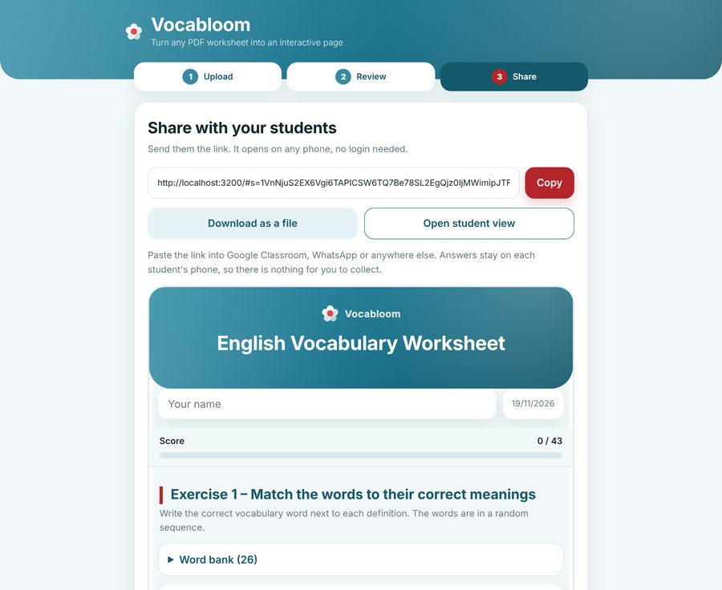
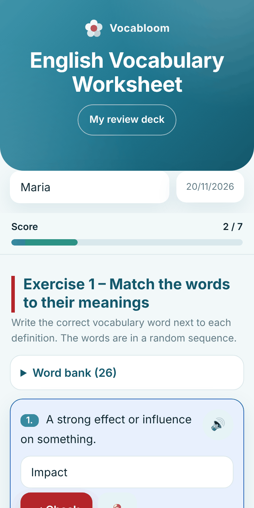
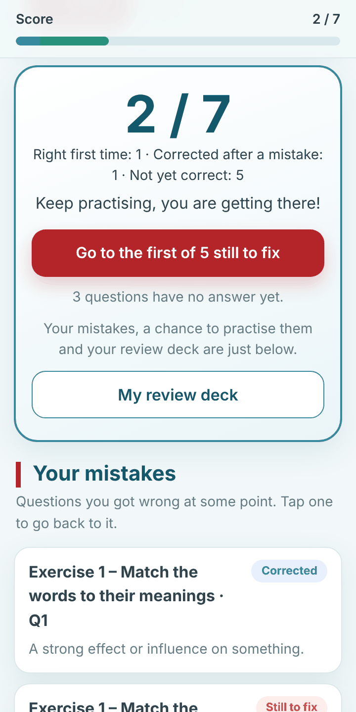
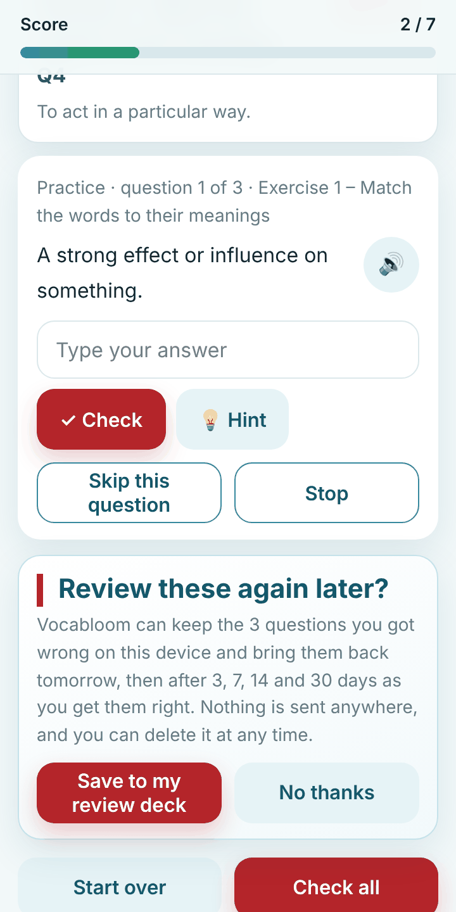
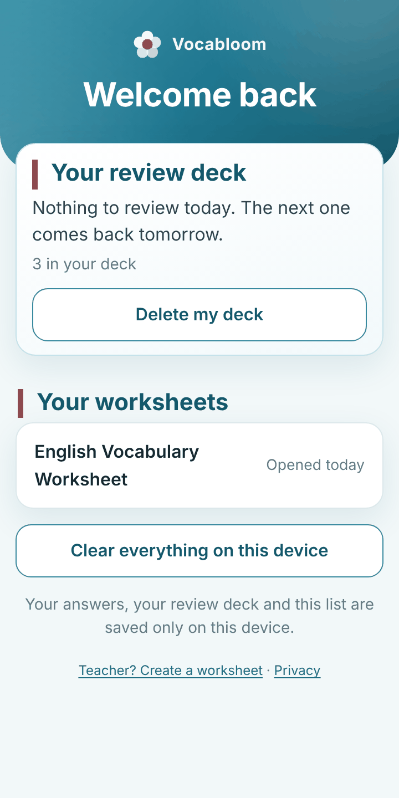
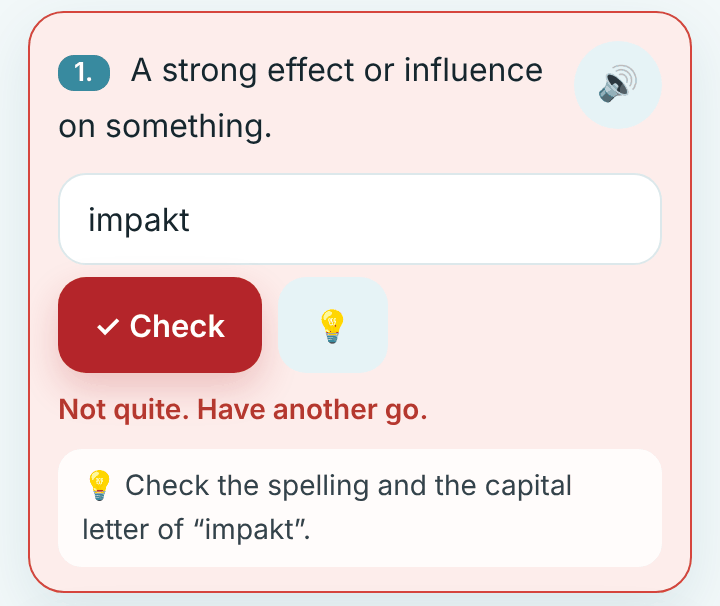
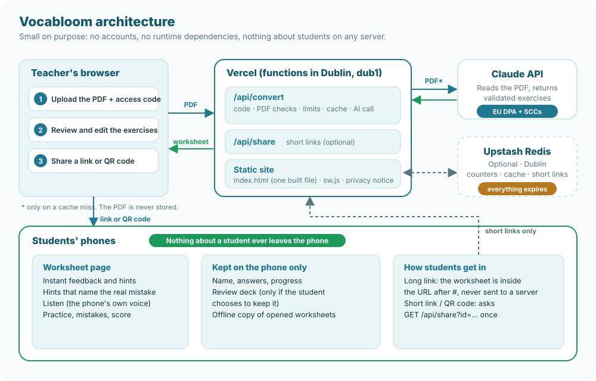
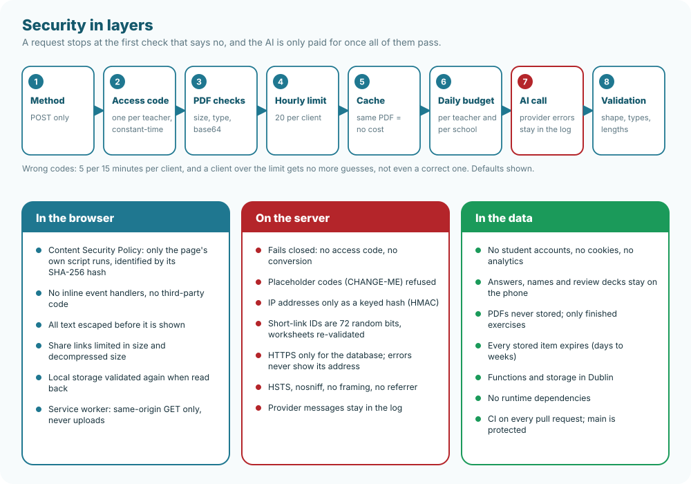
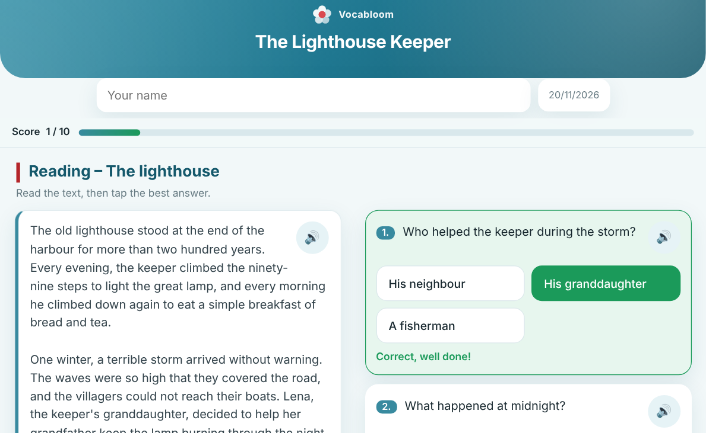

<div align="center">

# Vocabloom

**Turn any PDF worksheet into an interactive page that students answer on their phone.**

[](https://github.com/AlexandroCunha/vocabloom/actions/workflows/ci.yml)


[](LICENSE)


</div>

A teacher uploads a PDF. An AI (Claude) reads it and builds the exercises. The teacher checks them and gets one link, or a QR code, to share in Google Classroom, WhatsApp, email, anywhere. Students open it on their phone, answer, get feedback that names their real mistake, listen to the questions, and keep the ones they got wrong in a small review deck.

**No student accounts, and nothing about students is ever sent to a server.**

## Contents

1. [At a glance](#at-a-glance)
2. [How it works](#how-it-works)
3. [Screens](#screens)
4. [Architecture](#architecture)
5. [Security and privacy](#security-and-privacy)
6. [Before you go live](#before-you-go-live)
7. [Run it locally](#run-it-locally)
8. [Deploy on Vercel](#deploy-on-vercel)
9. [Phones, computers and foldables](#phones-computers-and-foldables)
10. [Project structure](#project-structure)
11. [Documentation map](#documentation-map)
12. [Limits to know](#limits-to-know)

## At a glance

| | |
|---|---|
| **Any PDF** | Vocabulary, grammar, reading, true/false, matching, open writing. The AI finds the exercises and uses only what is in the PDF: no invented questions, original wording and order. |
| **Feedback that names the mistake** | A hint says what the student actually got wrong (*Check the spelling and the capital letter of "brazillian"*), never the answer. After a second mistake, a short explanation in British English. |
| **Mistakes, practice, review deck** | The page lists what was wrong and what was corrected. Practice is optional and never changes the score. If the student chooses, wrong answers come back after 1, 3, 7, 14 and 30 days, kept only on the phone. |
| **After "Check all"** | A result card, a button to the first question still to fix, then mistakes, practice and the review deck. |
| **Listen** | A speaker on every question and word-bank word, in British English, using the phone's own voice. Nothing is recorded or sent. |
| **Link or QR code** | The normal link holds the whole worksheet. One click makes a short link and a QR code for the classroom screen or a printed sheet. |
| **Install and offline** | Add it to the home screen. The app and every worksheet already opened work without a connection. |
| **Cost control** | One access code per teacher, daily limits, a cache so the same PDF is never paid for twice, and a monthly spend limit at the AI provider. |
| **Every screen** | Phone first, with care for the iPhone and the iPhone Duo. A wide layout on a computer. |

**Exercise types:** fill in the blanks, short answer, multiple choice, true/false, matching and open writing, with word banks and reading texts.

## How it works

| 1. Upload | 2. Review | 3. Share |
|---|---|---|
| Pick a PDF and type your access code. The same PDF converted recently comes back at no cost (**Convert again** if you want a fresh one). | The AI shows the exercises it built. With no answer key in the PDF, it works the answers out, so the teacher checks and edits answers, hints and explanations. | Copy the link into Classroom or WhatsApp. Answers stay on each student's phone: nothing to collect. With the database on, **Create short link and QR code** makes a link of about 50 characters. |

<p align="center">
  
  
</p>

## Screens

<table>
  <tr>
    <td align="center" width="33%"><br><b>The worksheet</b><br><sub>One question per card, progress saved on the phone.</sub></td>
    <td align="center" width="33%"><br><b>Listen</b><br><sub>British English where the phone has a voice. Only the worksheet's text is read.</sub></td>
    <td align="center" width="33%"><br><b>After “Check all”</b><br><sub>Score, a jump to what is left, then mistakes and the review deck.</sub></td>
  </tr>
  <tr>
    <td align="center"><br><b>Mistakes</b><br><sub>Corrected, or still to fix. Tap one to go back to it.</sub></td>
    <td align="center"><br><b>Optional practice</b><br><sub>The same questions, one at a time. It never changes the score.</sub></td>
    <td align="center"><br><b>Review deck</b><br><sub>Nothing is saved until the student says yes.</sub></td>
  </tr>
  <tr>
    <td align="center"><br><b>Home page</b><br><sub>What is ready today, recent worksheets, and <i>Clear everything on this device</i>.</sub></td>
    <td align="center"><br><b>Offline</b><br><sub>Opened worksheets still work without a connection.</sub></td>
    <td align="center"><br><b>A hint for the real mistake</b><br><sub>Spelling and capital letters are named, the answer is not.</sub></td>
  </tr>
</table>

**How students find their deck.** A **My review deck** button sits at the top of every worksheet opened from a link, on the result card, and on the deck card once it is saved. The teacher's page links to it too. On a phone, **Add to Home Screen** makes the installed app open on the home page.

**Install.** Android: open the link in Chrome and choose **Install app**. iPhone: open it in Safari, tap **Share**, then **Add to Home Screen**.

## Architecture

<p align="center">
  
</p>

- **The server never stores a PDF or a student's answer.** A serverless function converts PDFs; everything else happens in the browser.
- **The optional database** (Upstash Redis, Dublin) adds spending limits that hold across servers, a cache for repeat conversions and short links. Every item in it expires.
- **A long link carries the whole worksheet** after the `#`, which browsers never send to a server.
- **No dependencies at runtime.** The page is one generated file (`public/index.html`) built from small scripts in `src/`, so a worksheet can also be downloaded as a single `.html` file.

A conversion request passes these checks, in order, and stops at the first that says no:

| | Check | What it protects |
|---|---|---|
| 1 | Method (`POST` only) | The surface of the endpoint |
| 2 | Access code (one per teacher, constant-time) | Your API credit |
| 3 | The PDF (size, type, base64) | Nothing is paid for before it passes |
| 4 | Conversions per hour, per client | Bursts |
| 5 | The cache (SHA-256 of the PDF) | The same PDF is never paid for twice |
| 6 | Daily budget, per teacher and per school | The total bill |
| 7 | The AI call | Provider errors stay in the server log |
| 8 | Output validation (`lib/normalize.js`) | Whatever the AI returns is reduced to the exact shape the page expects |

The full design (layers, the store, short links, frontend modules, the service worker) is in [`docs/ARCHITECTURE.md`](docs/ARCHITECTURE.md).

## Security and privacy

<p align="center">
  
</p>

| Threat | Defence |
|---|---|
| Strangers spending API credit | Access codes, wrong-code limits, hourly limits, daily budgets, a cache, and a monthly spend limit at the AI provider |
| A leaked code | Delete that teacher's pair in `ACCESS_CODES` and redeploy: the others keep working. Codes that still say `CHANGE-ME` are refused |
| Missing or placeholder configuration | Fails closed: production refuses to convert without an access code |
| Script injection (XSS) | Strict CSP: only the page's own script runs, identified by its SHA-256 hash. No inline handlers, no third-party scripts. All text is escaped |
| Malicious or broken AI output | Validated and length-limited before use |
| Hostile share links | Size and decompressed-size limits (zip-bomb protection), strict link formats |
| Tampered browser storage | Everything read back is validated again, and stored links must match the exact shape of a worksheet link |
| IP addresses | Never stored or logged: counters use a keyed hash |
| Clickjacking, sniffing, leaks | `frame-ancestors 'none'`, `nosniff`, `Referrer-Policy: no-referrer`, HSTS, minimal Permissions-Policy |
| Supply chain | No runtime dependencies; CI on every pull request; `main` is protected |

**Privacy (EU).** No cookies, no analytics, no third-party fonts or scripts, no student accounts. Student answers, names and review decks stay in the student's own browser. Functions and storage run in Dublin. [`public/privacy.html`](public/privacy.html) is a privacy notice **template** the school must complete and have reviewed.

**Do not upload personal data.** The PDF is sent to the AI provider to be converted. Before use with students, the school needs a data processing agreement and a lawful basis. A GDPR and AI Act checklist is in [`docs/COMPLIANCE.md`](docs/COMPLIANCE.md). To report a vulnerability, see [`SECURITY.md`](SECURITY.md).

## Before you go live

- [ ] Set a **monthly spend limit** in the AI provider's console. It is the one limit nothing else can bypass.
- [ ] Set `ANTHROPIC_API_KEY` and a personal code per teacher in `ACCESS_CODES`. Remove any `CHANGE-ME` placeholder.
- [ ] If you use the database: add Upstash from the Vercel Marketplace in a European region, and sign the agreement with the storage provider.
- [ ] Complete [`public/privacy.html`](public/privacy.html): address, legal basis, and how the school informs students and parents. Then remove the yellow *For the school* note.
- [ ] Open a short link with a real access code and check that it works end to end.
- [ ] Try the page on a real iPhone (and an iPhone Duo, if you have one). Those layouts have only been checked in Chrome.
- [ ] Confirm `main` is protected and the `test` check passes.
- [ ] Tell students and parents how the tool is used, and, on shared computers, to use **Clear everything on this device**.

## Run it locally

Node 18 or newer. No `npm install` needed.

```bash
cp .env.example .env      # add your ANTHROPIC_API_KEY and replace the CHANGE-ME access codes
node server.js            # http://localhost:3000
```

Without an API key (returns a demo worksheet for any PDF):

```bash
MOCK=1 node server.js
```

To try short links and QR codes without an account anywhere, start the stand-in database in another terminal:

```bash
node scripts/fake-redis.js
UPSTASH_REDIS_REST_URL=http://127.0.0.1:8787 UPSTASH_REDIS_REST_TOKEN=test-token MOCK=1 node server.js
```

Tests: `npm test`. After changing anything in `src/`, run `npm run build`; the tests fail if the generated files are out of date.

## Deploy on Vercel

The free plan is enough to start.

1. Push this repository to GitHub.
2. In Vercel: **Add New > Project**, import the repository. No build settings needed.
3. In **Settings > Environment Variables**, add the variables below, then redeploy.
4. Share the Vercel URL, and each teacher's own code, with your teachers.

| Variable | Required | Description |
|---|---|---|
| `ANTHROPIC_API_KEY` | Yes | Your Claude API key. |
| `ACCESS_CODES` | Yes (or `ACCESS_CODE`) | One personal code per teacher: `anna:a-long-code,ben:another-long-code`. To withdraw someone, delete their pair and redeploy. |
| `ACCESS_CODE` | Alternative | A single code for the whole school. Simpler, but cannot be withdrawn for one person. Both can be used together. |
| `DAILY_LIMIT_PER_TEACHER` | No | Conversions per teacher per day (UTC). Default 30, `0` for no limit. |
| `DAILY_LIMIT_TOTAL` | No | Conversions per day for the whole school. Default 150, `0` for no limit. |
| `CACHE_TTL_DAYS` | No | Days to remember a conversion. Default 7, `0` switches it off. Needs the database to be shared between servers. |
| `UPSTASH_REDIS_REST_URL`, `UPSTASH_REDIS_REST_TOKEN` | No | The optional database. Adding Upstash from the Vercel Marketplace fills them in. |
| `SHARE_TTL_DAYS` | No | Days a short link keeps working. Default 90. |
| `RATE_LIMIT_SECRET` | No | A long random string used to scramble visitors' IP addresses before they are counted. |
| `CLAUDE_MODEL` | No | Defaults to `claude-sonnet-5-5`. |

Without any access code, the live site refuses to convert: anyone with the URL could otherwise spend your API credit.

**Controlling the cost.** A conversion costs a small amount of API usage (typically cents). Three layers keep it predictable: per-teacher codes with daily limits, a cache of finished exercises (never the PDF), and the monthly spend limit in the AI provider's console.

**Short links and QR codes.** A normal link holds the whole worksheet, which is too long for a good QR code. Short links keep a copy of the worksheet on the server for `SHARE_TTL_DAYS`, so they need a small database: in Vercel open **Storage** (or **Marketplace**), add **Upstash for Redis** in a European region, and redeploy. Without it everything else works; limits and the cache then count per server instance, and the short-link box is not shown. A school that turns the database on should update its privacy notice (it has a section for this). See [`docs/COMPLIANCE.md`](docs/COMPLIANCE.md).

## Phones, computers and foldables

Phone first, with a wider layout on a computer.

- **iPhone.** Keeps clear of the notch and home indicator, even sideways. Fields never make Safari zoom in. **Share…** opens the iPhone's own share sheet.
- **Computer.** The teacher's tool takes a dropped PDF, works from the keyboard and uses two columns. Students get arrow-key navigation.
- **iPhone Duo and other foldables.** The layout follows the size and shape of the window: held sideways, a worksheet becomes a two-page spread and the student stays on the same question when the phone is opened, closed or turned.

<p align="center">
  
  
</p>
<p align="center">
  
</p>

Sizes, fold features and how each rule was checked: [`docs/DEVICES.md`](docs/DEVICES.md).

## Project structure

```
api/                   convert.js (POST /api/convert) and share.js (short links)
lib/                   config, access codes, limits, storage, cache, short links, PDF checks,
                       AI adapter, prompt, output validation, security headers, HTTP helpers
src/                   frontend source: scripts grouped by responsibility, styles, HTML and service worker templates
scripts/               build.js (src/ -> public/), make-icons.js, fake-redis.js
public/                what the site serves: index.html and sw.js (generated), demo worksheet, manifest, icons, privacy notice
server.js              zero-dependency local server
test/                  tests, using Node's built-in test runner
docs/                  ARCHITECTURE.md, COMPLIANCE.md, DEVICES.md and the images used in these pages
.github/workflows/     CI: the tests run on every push and pull request
```

`main` is protected: changes go through a pull request and the `test` check must pass. Functions run in the Dublin region (`vercel.json`).

## Documentation map

| Document | What is in it |
|---|---|
| [`docs/ARCHITECTURE.md`](docs/ARCHITECTURE.md) | Layers, the conversion request, the store, short links, frontend modules, offline, the security design |
| [`docs/COMPLIANCE.md`](docs/COMPLIANCE.md) | What data exists and where, roles under the GDPR, the checklist for schools |
| [`docs/DEVICES.md`](docs/DEVICES.md) | iPhone, computer and foldable layouts, and how they were checked |
| [`SECURITY.md`](SECURITY.md) | How to report a vulnerability, practices, what to do if a code leaks |
| [`public/privacy.html`](public/privacy.html) | The privacy notice template for the school to complete |

## Limits to know

- PDFs up to about 3 MB (Vercel request limit). Very long PDFs may be refused: split them.
- Each conversion costs a small amount of API usage (typically cents).
- Read-aloud uses the voices of the student's phone or browser, so quality varies. Some browsers use an online voice; the privacy notice says so.
- Safari on iPhone can delete what a website saved (answers, review deck, offline copies) after about a week without a visit, unless the site was added to the Home Screen.
- The layouts are checked in Chrome at phone and computer sizes, including a simulated notch and the sizes Safari 27.1 reports for the iPhone Duo. They have **not** been tried on a real iPhone, an iPhone Duo or in Safari. Safari's fold features are off by default and may change.
- Student results are not stored on a server, by design. The review deck is per phone and per browser and does not follow a student to another device. A platform with classes, accounts and dashboards would be a separate project with its own data protection work.

## Licence

MIT. See [`LICENSE`](LICENSE).
