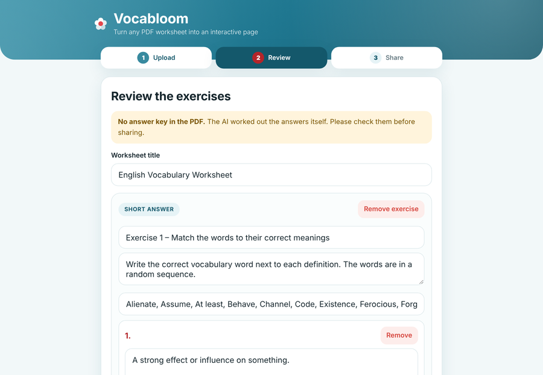

# Vocabloom

**Turn any PDF worksheet into an interactive page that students answer on their phone.**

A teacher uploads a PDF, an AI (Claude) reads it and builds the exercises, the teacher checks them, and gets one link to share (in Google Classroom, WhatsApp, email, anywhere). Students open the link on their phone, answer, get instant feedback, and practise the questions they got wrong. No student accounts, no database.

<p align="center">
  
</p>

## What it does

| | |
|---|---|
| **Any PDF** | Vocabulary, grammar, reading, true/false, matching, open writing. The AI finds the exercises. |
| **Faithful to the PDF** | The AI only uses what is in the PDF. It never invents questions or vocabulary, and keeps the original wording and order. |
| **Instant feedback** | Students check each answer, see a score and a progress bar, and get confetti when everything is right. |
| **Hints and explanations** | When a student gets something wrong, a hint appears. After a second mistake, a short explanation in British English. |
| **Mistake tracking** | The page shows which questions were wrong at some point and which were corrected afterwards. |
| **Optional practice** | After making mistakes, students can choose **Practise now** or **No thanks, skip**. Practice re-asks the same questions from the PDF and never changes the score. |
| **Share anywhere** | One link (the worksheet is stored inside the link), or download a single `.html` file. |

**Exercise types:** fill in the blanks, short answer, multiple choice, true/false, matching, open writing (with word banks and reading texts).

## How it works

### 1. Upload
Pick a PDF and type the school access code.

### 2. Review
The AI shows the exercises it built. If the PDF has no answer key, the AI works out the answers itself, so the teacher checks and edits them (answers, hints and explanations) before sharing.

<p align="center">
  
</p>

### 3. Share
The teacher copies the link and pastes it into Google Classroom, WhatsApp or anywhere else. Answers stay on each student's phone, so there is nothing for the teacher to collect.

<p align="center">
  
</p>

## The student view

Built for phones: large tap targets, one question per card, progress saved in the browser.

<p align="center">
  
  &nbsp;&nbsp;
  
</p>

### Mistakes and optional practice

<p align="center">
  
  &nbsp;&nbsp;
  
</p>

## Run locally

Requires Node 18 or newer. No `npm install` needed.

```bash
cp .env.example .env      # add your ANTHROPIC_API_KEY and ACCESS_CODE
node server.js            # http://localhost:3000
```

Try it without an API key (returns a demo worksheet for any PDF):

```bash
MOCK=1 node server.js
```

## Deploy on Vercel

The free plan is enough to start.

1. Push this repository to GitHub.
2. In Vercel: **Add New > Project**, then import the repository. No build settings needed.
3. In **Settings > Environment Variables**, add the variables below, then redeploy.
4. Share the Vercel URL and the access code with your teachers.

| Variable | Required | Description |
|---|---|---|
| `ANTHROPIC_API_KEY` | Yes | Your Claude API key. |
| `ACCESS_CODE` | Yes | The shared password teachers type on the site. Use a long one. Without it, anyone with the URL can spend your API credits. |
| `CLAUDE_MODEL` | No | Defaults to `claude-sonnet-5-5`. |

## Project structure

```
api/convert.js         POST /api/convert: guards the request, then delegates to lib/
lib/                   config, PDF checks, AI adapter, prompt, output validation, security, HTTP helpers
src/                   frontend source: small scripts grouped by responsibility, styles, HTML template
scripts/build.js       builds src/ into the single-file public/index.html (and keeps the CSP hash in step)
public/                what the website serves (index.html is generated), demo worksheet, privacy notice
server.js              zero-dependency local server
test/                  tests (Node's built-in test runner)
docs/                  ARCHITECTURE.md and COMPLIANCE.md
```

After changing anything in `src/`, run `npm run build`. The tests fail if the generated files are out of date. More in [`docs/ARCHITECTURE.md`](docs/ARCHITECTURE.md).

## Security and privacy (EU)

- **GDPR by design:** no database, no cookies, no analytics, no third-party fonts or scripts. Student answers stay in the student's own browser. See [`public/privacy.html`](public/privacy.html): a privacy notice **template** that the school must complete and have reviewed.
- **Do not upload personal data.** The PDF is sent to the AI provider to be converted. Before use with students, the school needs a data processing agreement and a lawful basis, and should check where the provider processes data.
- **Hardening:** strict security headers (CSP that allows only the page's own script by hash, HSTS, `nosniff`, no framing), access code compared in constant time, limits on wrong codes and on conversions, validated AI output, escaped HTML, size-limited share links, no runtime dependencies. Details in [`SECURITY.md`](SECURITY.md) and [`docs/ARCHITECTURE.md`](docs/ARCHITECTURE.md). A GDPR and AI Act checklist for schools is in [`docs/COMPLIANCE.md`](docs/COMPLIANCE.md).
- **Rate limits are best effort.** They live in server memory, so on Vercel each instance counts separately. For a hard limit, add Vercel's firewall or rate limiting.
- Keep `ACCESS_CODE` secret, and change it if it leaks.

## Tests

```bash
npm test
```

The `main` branch is protected: changes go through a pull request and the `test` check must pass. Functions run in the Dublin region (`vercel.json`).

## Limits to know

- PDFs up to about 3 MB (Vercel request limit). Very long PDFs may be refused: split them.
- Each conversion costs a small amount of API usage (typically cents).
- Student results are not stored on a server, by design. A platform with classes, accounts and teacher dashboards needs a database: that is a separate, future project.

## Licence

MIT. See [`LICENSE`](LICENSE).
