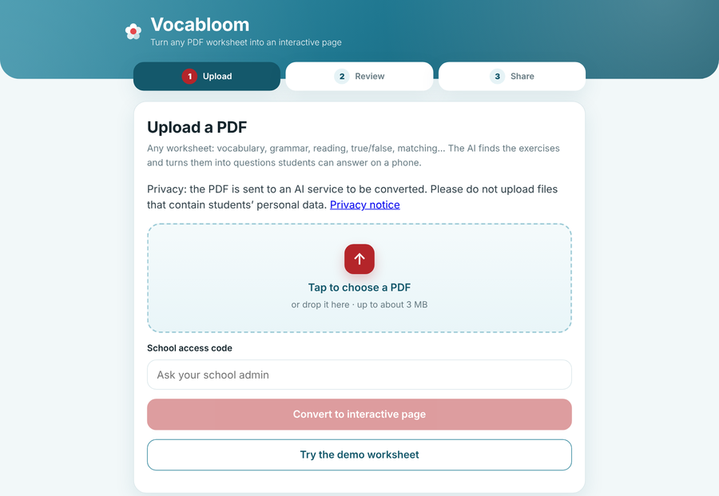
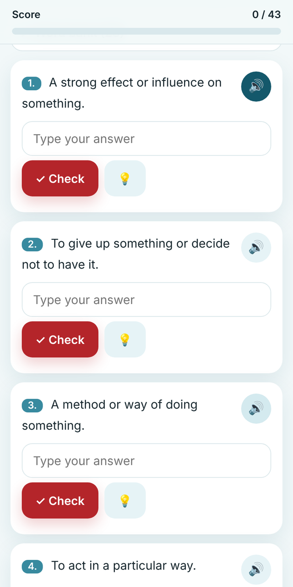
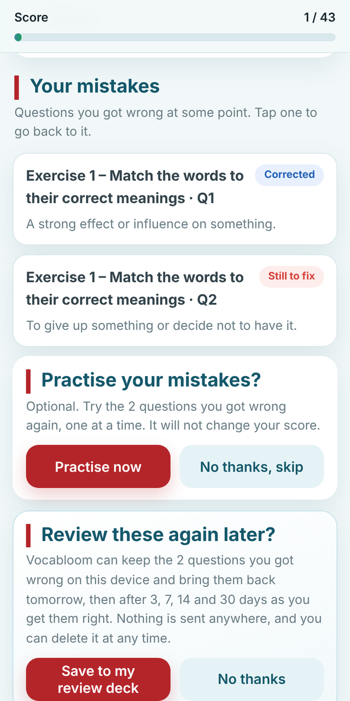
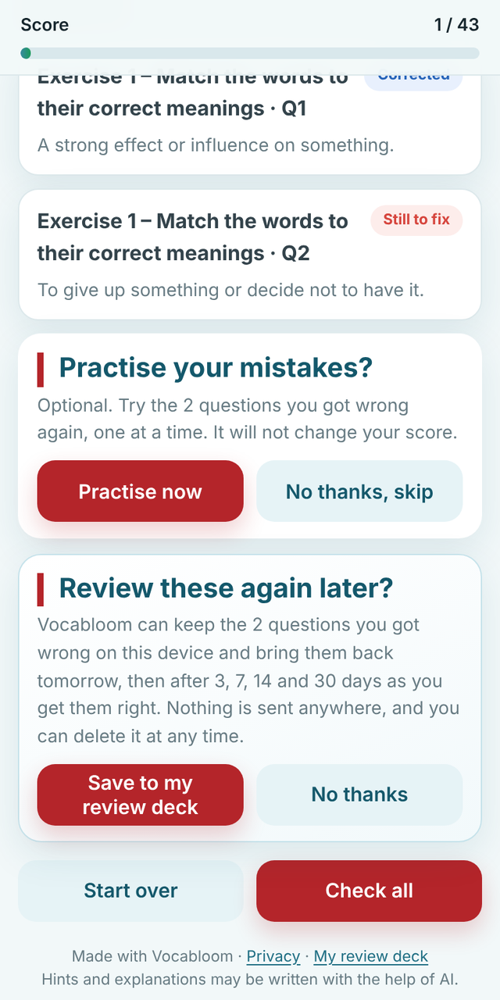
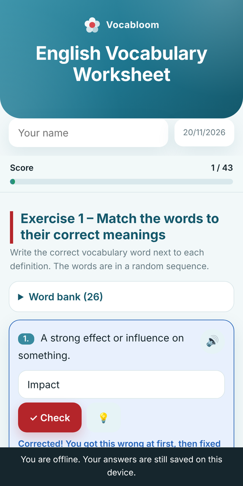
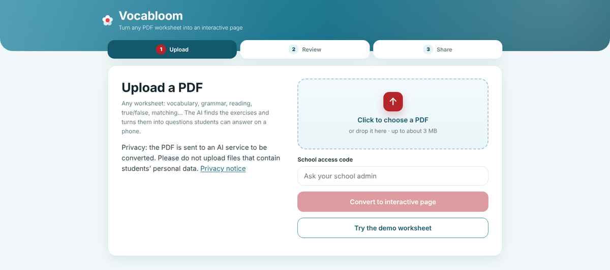
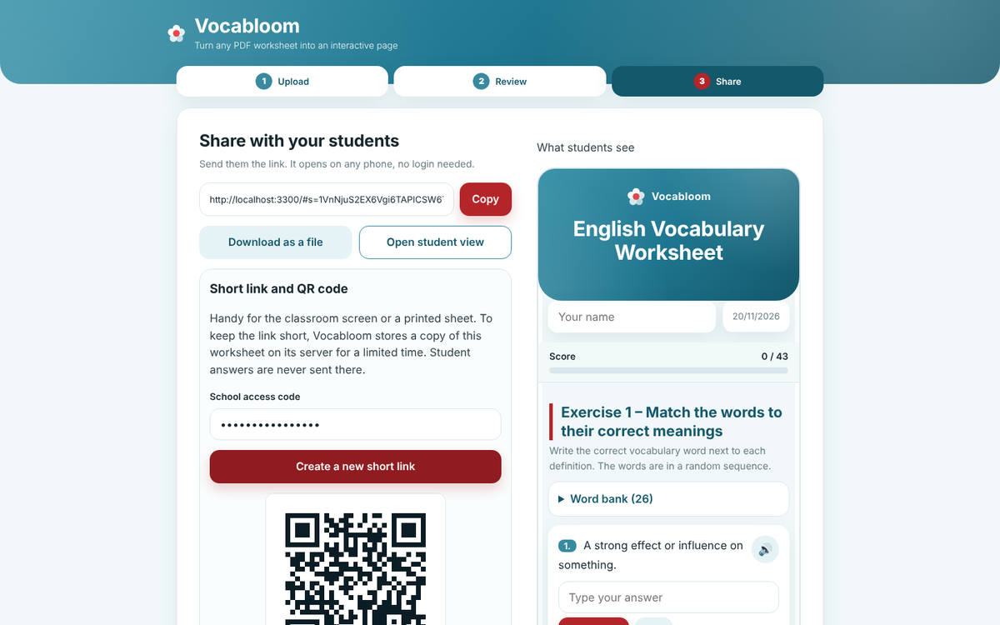

# Vocabloom

**Turn any PDF worksheet into an interactive page that students answer on their phone.**

A teacher uploads a PDF, an AI (Claude) reads it and builds the exercises, the teacher checks them, and gets one link (or a QR code) to share in Google Classroom, WhatsApp, email, anywhere. Students open it on their phone, answer, get instant feedback, listen to the questions, and keep the ones they got wrong in a small review deck. No student accounts, and nothing about students is ever sent to a server.

<p align="center">
  
</p>

## What it does

| | |
|---|---|
| **Any PDF** | Vocabulary, grammar, reading, true/false, matching, open writing. The AI finds the exercises. |
| **Faithful to the PDF** | The AI only uses what is in the PDF. It never invents questions or vocabulary, and keeps the original wording and order. |
| **Instant feedback** | Students check each answer, see a score and a progress bar, and get confetti when everything is right. |
| **Hints and explanations** | When a student gets something wrong, a hint appears. After a second mistake, a short explanation in British English. |
| **Mistake tracking** | The page shows which questions were wrong at some point and which were corrected afterwards. |
| **Optional practice** | After making mistakes, students can choose **Practise now** or **No thanks, skip**. Practice re-asks the same questions from the PDF and never changes the score. |
| **Listen** | A speaker button on every question, and every word in a word bank, reads it aloud in British English using the phone's own voices. Nothing is recorded or sent. |
| **Review deck** | If the student chooses to, wrong answers come back after 1, 3, 7, 14 and 30 days, across worksheets. It lives only on the student's phone. |
| **Link or QR code** | The normal link holds the whole worksheet. For the classroom screen or a printed sheet, one click makes a short link and a QR code. |
| **Phones and computers** | Phone first, with care for the iPhone: the page keeps clear of the notch and home indicator, never makes Safari zoom in on a field, and the teacher's **Share…** button opens the iPhone's own share sheet. On a computer the teacher's tool has a wider layout, takes a PDF dropped on it and works from the keyboard. |
| **Install and offline** | Students can add Vocabloom to their home screen. The app and every worksheet they have opened still work without a connection. |
| **Cost control** | One access code per teacher, daily limits, and a cache so the same PDF is never paid for twice. |

**Exercise types:** fill in the blanks, short answer, multiple choice, true/false, matching, open writing (with word banks and reading texts).

## How it works

### 1. Upload
Pick a PDF and type your access code. If the same PDF was converted recently, you get the earlier result at no cost, with a **Convert again** button if you want a fresh one.

### 2. Review
The AI shows the exercises it built. If the PDF has no answer key, the AI works out the answers itself, so the teacher checks and edits them (answers, hints and explanations) before sharing.

<p align="center">
  
</p>

### 3. Share
The teacher copies the link and pastes it into Google Classroom, WhatsApp or anywhere else. Answers stay on each student's phone, so there is nothing for the teacher to collect.

With a database switched on (see [Short links and QR codes](#short-links-and-qr-codes)), **Create short link and QR code** makes a link of about 50 characters and a QR code that can be shown large for a projector or downloaded as a PNG.

<p align="center">
  
</p>

## The student view

Built for phones: large tap targets, one question per card, progress saved in the browser.

<p align="center">
  
  &nbsp;&nbsp;
  
</p>

### Listen

Each question has a speaker button. In a word bank, tap a word to hear it. The voice is British English where the phone has one, and only the worksheet's text is read, never what the student typed. Where the browser cannot speak, the buttons are simply not shown.

<p align="center">
  
</p>

### Mistakes and optional practice

<p align="center">
  
  &nbsp;&nbsp;
  
</p>

### Review deck and home page

Practice is for now. The review deck is for later: after a mistake the student is offered **Save to my review deck**, and nothing is saved until they say yes. Saved questions come back after 1, 3, 7, 14 and 30 days.

The home page (**My review deck**, or the installed app) shows what is ready to review today and the worksheets the student opened recently. **Clear everything on this device** removes it all, which is useful on a shared computer.

<p align="center">
  
  &nbsp;&nbsp;
  
</p>

### Install it and use it offline

On Android, open the link in Chrome and choose **Install app** (or **Add to Home screen**). On iPhone, open it in Safari, tap **Share**, then **Add to Home Screen**. The app opens on the home page. Once a worksheet has been opened, it opens again without a connection, and answers are saved on the phone as usual.

<p align="center">
  
</p>

## Phones and computers

Vocabloom is built phone first and also suits a computer.

- **iPhone.** The page keeps clear of the notch and the home indicator, even held sideways, where the header also shrinks to leave room for the questions. Fields are never small enough to make Safari zoom in, and buttons do not stay highlighted after a tap. The teacher's **Share…** button opens the iPhone's own share sheet (Messages, WhatsApp, Mail), and sends the short link once one exists. An iPhone has no install button, so the review deck shows a tip: **Share**, then **Add to Home Screen**.
- **Computer.** The teacher's tool uses a wider layout: the upload box takes a dropped PDF and can be reached with the keyboard, the review fields sit in two columns, and the share step keeps a preview of the student's page in view beside the link and the QR code. Students get a slightly wider column, the arrow keys move between answer buttons, and Escape closes pop-ups. Hover colours appear only where there is a mouse.

<p align="center">
  
</p>

<p align="center">
  
</p>

<p align="center">
  
</p>

## Run locally

Requires Node 18 or newer. No `npm install` needed.

```bash
cp .env.example .env      # add your ANTHROPIC_API_KEY and replace the CHANGE-ME access codes
node server.js            # http://localhost:3000
```

Try it without an API key (returns a demo worksheet for any PDF):

```bash
MOCK=1 node server.js
```

To try short links and QR codes locally, without creating an account anywhere, start the built-in stand-in for the database in another terminal and give its two variables to the server:

```bash
node scripts/fake-redis.js
UPSTASH_REDIS_REST_URL=http://127.0.0.1:8787 UPSTASH_REDIS_REST_TOKEN=test-token MOCK=1 node server.js
```

## Deploy on Vercel

The free plan is enough to start.

1. Push this repository to GitHub.
2. In Vercel: **Add New > Project**, then import the repository. No build settings needed.
3. In **Settings > Environment Variables**, add the variables below, then redeploy.
4. Share the Vercel URL, and each teacher's own access code, with your teachers.

| Variable | Required | Description |
|---|---|---|
| `ANTHROPIC_API_KEY` | Yes | Your Claude API key. |
| `ACCESS_CODES` | Yes (or `ACCESS_CODE`) | One personal code per teacher: `anna:a-long-code,ben:another-long-code`. To withdraw someone, delete their pair and redeploy. Placeholder codes that still say `CHANGE-ME` are refused. |
| `ACCESS_CODE` | Alternative | A single code for the whole school. Simpler, but it cannot be withdrawn for one person. Both can be used together. |
| `DAILY_LIMIT_PER_TEACHER` | No | Conversions per teacher per day (UTC). Default 30, `0` for no limit. |
| `DAILY_LIMIT_TOTAL` | No | Conversions per day for the whole school. Default 150, `0` for no limit. |
| `CACHE_TTL_DAYS` | No | Days to remember a conversion, so the same PDF costs nothing again. Default 7, `0` switches it off. Needs the database to be shared between servers. |
| `UPSTASH_REDIS_REST_URL`, `UPSTASH_REDIS_REST_TOKEN` | No | The optional database. Adding Upstash from the Vercel Marketplace fills them in. See below. |
| `SHARE_TTL_DAYS` | No | Days a short link keeps working. Default 90. |
| `RATE_LIMIT_SECRET` | No | A long random string used to scramble visitors' IP addresses before they are counted. |
| `CLAUDE_MODEL` | No | Defaults to `claude-sonnet-5-5`. |

Without any access code, the live site refuses to convert: anyone with the URL could otherwise spend your API credits.

### Controlling the cost

Every conversion costs a small amount of API usage (typically cents). Three layers keep it predictable:

1. **Per-teacher codes and daily limits**, in this project (`ACCESS_CODES`, `DAILY_LIMIT_PER_TEACHER`, `DAILY_LIMIT_TOTAL`).
2. **A cache**: the same PDF is converted once, and the result is reused for `CACHE_TTL_DAYS`. Only the finished exercises are kept, never the PDF.
3. **A monthly spend limit in the AI provider's console** (in the Anthropic Console, under Settings, then Spend limits). This is the one limit that nothing else can bypass, so set it too. When it is reached, teachers see that the monthly AI budget has been used up.

### Short links and QR codes

A normal link holds the whole worksheet, which makes it too long for a good QR code. Short links keep a copy of the worksheet on the server for `SHARE_TTL_DAYS`, so they need a small database. The same database makes the limits and the cache work across all servers.

1. In Vercel, open your project, then **Storage** (or **Marketplace**) and add **Upstash for Redis**. Choose a region in Europe.
2. Vercel adds the two variables to the project. Redeploy.
3. In the teacher's **Share** step, **Short link and QR code** now appears.

Without the database everything else still works: limits and the cache only work within one server instance, and the short-link box is not shown. A school that turns the database on should update its privacy notice (it already has a section for this) and sign an agreement with the storage provider. See [`docs/COMPLIANCE.md`](docs/COMPLIANCE.md).

## Project structure

```
api/convert.js         POST /api/convert: who is asking, is the PDF acceptable, may it be paid for, convert
api/share.js           GET and POST /api/share: short links
lib/                   config, access codes, limits, storage, cache, short links, PDF checks, AI adapter,
                       prompt, output validation, security, HTTP helpers
src/                   frontend source: small scripts grouped by responsibility, styles, HTML template,
                       service worker template
scripts/build.js       builds src/ into the single-file public/index.html and public/sw.js, and keeps the CSP hash in step
scripts/make-icons.js  draws the app icons (no image library)
scripts/fake-redis.js  a tiny stand-in for the database, for local use and tests
public/                what the website serves (index.html and sw.js are generated), demo worksheet, manifest, icons, privacy notice
server.js              zero-dependency local server
test/                  tests (Node's built-in test runner)
docs/                  ARCHITECTURE.md and COMPLIANCE.md
```

After changing anything in `src/`, run `npm run build`. The tests fail if the generated files are out of date. More in [`docs/ARCHITECTURE.md`](docs/ARCHITECTURE.md).

## Security and privacy (EU)

- **GDPR by design:** no cookies, no analytics, no third-party fonts or scripts, no student accounts. Student answers, names and review decks stay in the student's own browser. The optional database holds only teaching material and counters, and every item in it expires. See [`public/privacy.html`](public/privacy.html): a privacy notice **template** that the school must complete and have reviewed.
- **Do not upload personal data.** The PDF is sent to the AI provider to be converted. Before use with students, the school needs a data processing agreement and a lawful basis, and should check where the provider processes data.
- **Hardening:** strict security headers (CSP that allows only the page's own script by hash, HSTS, `nosniff`, no framing), access codes compared in constant time, limits on wrong codes, conversions and daily use, IP addresses only as keyed hashes, validated AI output, escaped HTML, size-limited share links, a service worker that never touches uploads, no runtime dependencies. Details in [`SECURITY.md`](SECURITY.md) and [`docs/ARCHITECTURE.md`](docs/ARCHITECTURE.md). A GDPR and AI Act checklist for schools is in [`docs/COMPLIANCE.md`](docs/COMPLIANCE.md).
- **Limits are shared across servers only with the database.** Without it each server instance counts separately. Either way, set a monthly spend limit in the AI provider's console.
- Keep every access code secret, and withdraw a code if it leaks.

## Tests

```bash
npm test
```

The `main` branch is protected: changes go through a pull request and the `test` check must pass. Functions run in the Dublin region (`vercel.json`).

## Limits to know

- PDFs up to about 3 MB (Vercel request limit). Very long PDFs may be refused: split them.
- Each conversion costs a small amount of API usage (typically cents).
- Read-aloud uses the voices of the student's phone or browser, so quality varies by device. Some browsers use an online voice; the privacy notice says so.
- Safari on iPhone can delete what a website saved (answers, review deck, offline copies) when the site has not been opened for about a week, unless it was added to the Home Screen. That is why the review deck suggests **Add to Home Screen** on an iPhone.
- The layouts are checked in Chrome at phone and computer sizes, including a simulated notch. Please also try them on a real iPhone (Safari) and report anything odd.
- Student results are not stored on a server, by design. The review deck is per phone and per browser: it does not follow a student to another device. A platform with classes, accounts and teacher dashboards needs a database of its own: that is a separate, future project.

## Licence

MIT. See [`LICENSE`](LICENSE).
