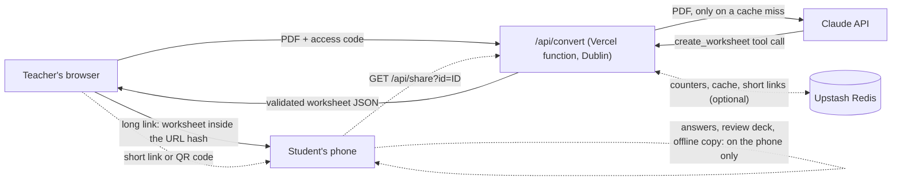

# Architecture

Vocabloom is deliberately small: **no accounts, no runtime dependencies, and nothing about students on any server.** A serverless function converts PDFs, and the rest happens in the browser. An optional small database (Upstash Redis) adds spending limits that hold across servers, a cache for repeat conversions, and short links with QR codes.

## The big picture



- The server **never stores a PDF or a student's answer.** Nothing about a student ever leaves the phone.
- Without the optional database, nothing is stored durably: counters and the cache live in the memory of a running server instance and disappear when it stops. The share link contains the whole worksheet, compressed, after the `#`, and browsers do not send that part to a server.
- With the database, the server keeps three kinds of data, each with an expiry: usage counters (days), converted worksheets by PDF fingerprint (`CACHE_TTL_DAYS`, 7 by default) and short-link worksheets (`SHARE_TTL_DAYS`, 90 by default). Everything is listed in [`COMPLIANCE.md`](COMPLIANCE.md).
- Students talk to the server only to load the page, and, when they open a short link, to fetch that one worksheet.

## Layers

| Layer | Where | Responsibility |
|---|---|---|
| HTTP entry | `api/convert.js`, `api/share.js`, `server.js` | Each file orchestrates one kind of request. `server.js` is only the local development server. |
| Configuration | `lib/config.js` | The only place that reads environment variables, plus every limit and default. |
| Who is asking | `lib/access.js`, `lib/security.js` | Access codes (one per teacher, constant-time check), wrong-code limit, security headers, the keyed hash that stands in for an IP address. |
| Limits | `lib/limits.js` | Fixed-window limiters and the daily budget per teacher and per school. |
| Storage | `lib/store.js` | The only module that talks to a database. Redis, memory, and a wrapper that falls back to memory. |
| Features on the store | `lib/cache.js`, `lib/links.js` | The conversion cache and the short links. |
| Request checks | `lib/pdf.js`, `lib/http.js` | PDF checks, JSON responses. |
| AI adapter | `lib/claude.js`, `lib/prompt.js`, `lib/worksheet-schema.js` | The only code that talks to the AI provider. Turns every failure into a safe, friendly error. |
| Output safety | `lib/normalize.js` | Reduces whatever the AI (or a browser) sends to the exact shape, types and lengths the page expects. |
| Frontend source | `src/` | Small scripts grouped by responsibility (below), styles, the HTML template and the service worker template. |
| Build | `scripts/build.js` | Joins `src/` into the single file `public/index.html`, writes `public/sw.js`, and keeps the CSP hash in step. |

Dependencies point inwards: the handlers use `lib/`, and `lib/` never imports a handler.

### One conversion request

`api/convert.js` runs these steps in order and stops at the first that says no:

1. **Method.** Only `POST`.
2. **Who is asking.** The access code is checked against the teachers in `ACCESS_CODES` (or the older `ACCESS_CODE`). Wrong codes are limited to 5 per 15 minutes per client, and a client over the limit gets no more guesses, not even a correct one.
3. **The PDF.** Size, type and base64 checks, before anything is counted or paid for.
4. **Conversions per hour.** 20 per client. Cached answers count here too.
5. **The cache.** If the same PDF (by SHA-256) was converted recently with the same prompt, schema and model, it is returned at no cost and does not use up the daily budget. The teacher can press **Convert again** to skip the cache.
6. **The daily budget.** 30 per teacher and 150 for the whole school per UTC day by default. A shared `ACCESS_CODE` counts against the school total only.
7. **The AI call.** The result is validated and length-limited by `lib/normalize.js`.
8. **Recording.** Usage is counted and the worksheet is cached. A failure here never loses a worksheet that was already paid for. A provider that is down or busy (502, 503) costs nothing and is not counted; "no exercises found" and "too long" (422) mean the AI did read the PDF, so they are counted.

`api/share.js` follows the same pattern: reading a short link needs no code and is limited per minute in the instance's own memory (it costs next to nothing); creating one needs a code and is limited per hour in the shared store.

### The store

`lib/store.js` hides the database behind five calls: `hit` (count), `peek` (look without counting), `forget`, `getJson` and `putJson`. Every key starts with `vb:` and has an expiry.

| | Used when | Behaviour |
|---|---|---|
| Upstash Redis (REST) | `UPSTASH_REDIS_REST_URL` and `_TOKEN` are set | Shared by every serverless instance. The address must be HTTPS (plain `http://` is accepted only for `localhost`, for testing). Each call has a 3-second timeout, and errors never include the address or token. |
| Memory | Nothing is configured | Private to one instance, capped at 2,000 keys. Limits still work, but each instance counts separately, and short links are switched off. |
| Fallback | Redis stops answering | The call is answered from memory (never blocking a teacher) and one line is logged, at most once a minute. |

`store.shared` is the Redis backend on its own, with no fallback. Short links use it, because a link written to one instance's memory would not exist on the next one: they return a clear "not available" message instead of guessing.

| Key | Holds | Expires |
|---|---|---|
| `vb:<limiter>:<client>` | A counter per limiter (wrong codes, conversions, short links created) | Its window (15 minutes to 1 hour) |
| `vb:day:<date>:t:<teacher>`, `vb:day:<date>:all` | Conversions today, per teacher and in total | 2 days |
| `vb:cache:<recipe>:<sha256 of the PDF>` | The validated worksheet (never the PDF) | `CACHE_TTL_DAYS` |
| `vb:link:<id>` | The validated worksheet behind a short link | `SHARE_TTL_DAYS` |

`<client>` is an HMAC of the visitor's IP address, keyed with `RATE_LIMIT_SECRET`, so an address is never stored or logged. `<recipe>` changes whenever the prompt, the tool schema or the model changes, so an old result is never reused after an improvement.

### Short links

A normal share link holds the whole worksheet (about 2,800 characters for a typical worksheet), which is too long for a good QR code. When the school has the database switched on, the teacher can create a **short link**: `https://site/#w=<12 characters>`. The ID is 72 random bits, so it cannot be guessed. Only the validated worksheet is stored (at most 200 KB). A student's phone asks `GET /api/share?id=ID` for it, and the server answers with the worksheet or a clear 404 once it has expired.

## Frontend modules (`src/js`)

Order matters, and is listed in `scripts/build.js`. Later files may use earlier ones; never the reverse.

```
core/ui.js             DOM helpers, escaping (esc), toast, clipboard, overlays, keyboard and file-drop helpers
core/text.js           answer matching (norm, alts), seeded shuffle, slug
core/worksheet.js      data model: defaults, scoring rule
core/grading.js        pure grading rules (no DOM, no state)
core/speech.js         read-aloud: what is spoken, chunking, voice choice (en-GB first)
core/deck.js           the review deck: Leitner boxes, due dates, safe loading from storage
core/local-data.js     recent worksheets and "clear everything on this device"
core/offline.js        service worker registration and the offline bar
core/platform.js       is this an iPhone in a browser tab? (only used to choose a tip)
share/codec.js         worksheet <-> URL hash (compression, size limits)
share/qr.js            QR code encoder (no library), SVG and canvas output
share/standalone.js    download as one self-contained .html file
player/state.js        what a student has done (local storage only)
player/items.js        index of questions by id
player/markup.js       HTML for the worksheet (everything escaped)
player/practice.js     one-question-at-a-time runner, used for practice and for review
player/deck-panel.js   the review-deck card (offer, status, review round, delete)
player/player.js       wires it together: feedback, score, listening, events
player/home.js         the student's home page: review deck and recent worksheets
teacher/upload.js      step 1
teacher/review.js      step 2
teacher/share.js       step 3: link, short link, QR code
teacher/teacher.js     the three steps
main.js                the router: teacher, worksheet or home
```

`core/`, `share/codec.js` and `share/qr.js` have no DOM dependency, so `test/frontend.test.js` runs them in Node. The QR encoder is checked against fixed test vectors, and was also decoded by two independent decoders (OpenCV's ArUco and WeChat readers) across every version it supports.

### The router (`main.js`)

| The page was opened as | Shows |
|---|---|
| A downloaded `.html` file (worksheet embedded) | The worksheet. It is the whole app, so there is no home page and no service worker. |
| `#s=...` or `#j=...` | A worksheet carried in the link itself. |
| `#w=ID` | A worksheet fetched with the short link ID. A damaged, expired, busy or unreachable link gets a specific message and a **Try again** button. |
| `#review` | The student's home: review deck and recent worksheets. |
| Nothing | The teacher's three steps. |

A navigation counter makes sure a slow worksheet from an earlier link can never replace a newer page.

### Why one built file?

A teacher can download a worksheet as a single `.html` file that works anywhere. The page does this by re-reading its own source, so the built page must stay one self-contained file. `public/index.html` is therefore **generated**: edit `src/`, then run `npm run build`. The tests fail if any generated file is out of date. The download leaves out the install links (manifest and home-screen icon), because a downloaded file is not part of the website.

### Student data on the device

Everything below lives in the browser's local storage, under keys that start with `vocabloom`, and is removed together by **Clear everything on this device**.

| Key | Holds |
|---|---|
| `vocabloom3:<worksheet>` | The student's name, answers and progress for one worksheet |
| `vocabloom-recent1` | Titles and links of the last 8 worksheets opened |
| `vocabloom-deck1` | The review deck. It exists **only after the student presses "Save to my review deck"** |

Anything read back is validated again (`sanitiseDeck`, `cleanRecent`): a damaged or edited value is ignored, and a stored link must match the exact shape of a worksheet link, so a tampered entry can never become a `javascript:` link. The teacher's preview never reads or writes any of it.

### Read-aloud

`core/speech.js` uses the browser's own speech synthesis. It asks for British English, prefers a voice that runs on the device, never starts by itself, and reads only the worksheet's text: never a student's name or answers. If the browser cannot speak, the listen buttons are not drawn.

### The review deck

A card that a student got wrong, and chose to keep, comes back after 1, 3, 7, 14 and 30 days (Leitner boxes). Right first time moves it up a box; anything else sends it back to box 1, due tomorrow. Right in the last box means it is learned and it leaves the deck. The deck holds at most 300 cards. A card's identity is a hash of its type, question and answers, so the same question from two worksheets is one card. Reviews reuse the same runner as "Practise your mistakes" (`player/practice.js`), configured with another prefix, so there is one set of question logic to test.

### Installable and offline

`public/manifest.webmanifest` and the icons (made by `scripts/make-icons.js`, with no image library) let a phone add Vocabloom to its home screen. It opens on the student's home page.

`src/sw.template.js` becomes `public/sw.js` at build time, with a version that is a hash of the service worker and of every app file, so any change produces a new version.

| Request | What the service worker does |
|---|---|
| The page, its icons, manifest and privacy notice | Keeps them in a cache named after the version. Served from the cache; the new version is installed in the background. |
| `GET /api/share?id=ID` (a short link) | Keeps every successful answer (up to 40), so a worksheet a student has opened works again offline. |
| Anything else, including every upload and conversion | Not touched. Only `GET` requests to the site's own origin are ever handled. |

A new version installs itself, replaces the old one, and deletes the old app cache; the stored worksheets are kept. The registration happens only on HTTPS (and `localhost`), and never for a downloaded file. `vercel.json` sets `Cache-Control: no-cache` on `/sw.js`, so a new version is noticed on the next visit.

### Phones and computers

The style sheets load in this order: `01-base` (colours, controls and the settings below), `02-shell-and-teacher`, `03-player`, and `04-devices`, which overrides the phone-first rules for particular devices. Two groups of settings live in `:root` of `01-base`:

- `--sat --sar --sab --sal`: the space the notch, the home indicator and the rounded corners take on an iPhone (`env(safe-area-inset-*)`, 0 everywhere else). The page asks to be drawn edge to edge (`viewport-fit=cover`), so every full-width bar adds these to its padding: `max(14px, var(--sal))` for the sides, `calc(10px + var(--sab))` at the bottom.
- `--col`: the width of the page column. 720px on a phone, 760px from 900px wide, and 960px for the teacher's tool (`#app.teacher`) from 1000px wide. Nothing else hard-codes a column width.

Rules that exist for one device, and the reason:

| Rule | Why |
|---|---|
| Hover colours only inside `@media (hover:hover)` | On a touch screen a tap leaves the hover colour stuck on the button. |
| Fields 16px or more under `(pointer:coarse)` | Safari on iPhone zooms the page in when a smaller field is selected. |
| `100dvh`, never `100vh` alone | The iPhone's toolbars change the height of the screen as they hide and show. |
| `touch-action: manipulation`, `format-detection`, `text-size-adjust` | No double-tap zoom, no numbers turned into phone links, no enlarged text when turned sideways. |
| Sideways phone (`orientation:landscape` and `max-height:500px`) | The header shrinks so the questions get the room. |
| The file input is hidden visually, not with `display:none` | The keyboard can reach the upload box. |
| `Share…` button only if `navigator.share` exists | iPhone, Android and Windows have a share sheet; other browsers do not. |
| A file dropped outside the upload box is ignored (`main.js`) | Otherwise the browser opens the PDF and the teacher loses the session. |

`test/devices.test.js` reads the style sheets and fails if one of these rules is removed (for example a `:hover` outside `@media (hover:hover)`, a `vh` without `dvh`, or a bar without its safe-area padding). How the screens look was checked in Chrome at 320 to 2560px wide, as an iPhone (touch, no hover), sideways, and with a notch simulated by setting the `--sa*` settings in the console, for example `document.documentElement.style.setProperty('--sal', '59px')`. It was not run on a real iPhone or in Safari: check there before a release.

## Security design

| Threat | Defence |
|---|---|
| Strangers spending API credits | Access codes (constant-time check, one per teacher, revocable), a limit on wrong codes, limits per hour per client, a daily budget per teacher and for the school, and a cache so repeat PDFs cost nothing |
| A leaked or shared code | Remove that teacher's entry and redeploy; the others keep working. Codes that still say `CHANGE-ME` are refused |
| Placeholder or missing configuration | Fails closed: any access setting means a code is required, and production refuses to convert at all without one |
| Malicious or broken AI output | `lib/normalize.js` validates and length-limits it; all text is escaped before display |
| A forged short-link request | The worksheet is validated again on the server before it is stored; IDs are 72 random bits; reading is rate limited |
| Script injection (XSS) | Strict CSP: only the page's own script runs, identified by its SHA-256 hash. No inline event handlers. No third-party scripts |
| Hostile share links | Link size limit, decompression limit (zip-bomb protection), strict hash and ID formats |
| Tampered local storage | Everything read back is validated; links must match the exact worksheet-link shape |
| A stale or poisoned offline cache | Only same-origin `GET` responses that succeeded are kept; the app cache is replaced on every new version |
| Raw IP addresses | Never stored or logged: counters use a keyed hash |
| Redis credentials | The address must be HTTPS; errors never contain it; the token never reaches a log |
| Path traversal on the dev server | `resolvePublicFile` refuses anything outside `public/` |
| Clickjacking, sniffing, leaks | `frame-ancestors 'none'`, `nosniff`, `Referrer-Policy: no-referrer`, HSTS, minimal Permissions-Policy |
| Supply chain | No runtime dependencies; CI runs the tests on every pull request; `main` needs a pull request |
| Leaking provider errors | Provider messages stay in the server log; users see friendly messages |

The CSP is `default-src 'none'` with only what the app needs: its own script (by hash), styles, images, fonts, API calls, the service worker and the manifest, all from its own origin.

Known trade-offs:
- Styles are `'unsafe-inline'` because the page sets style attributes (for example the width of a blank). Scripts, which matter most for XSS, are locked down by hash.
- If Redis is unreachable, limits fall back to per-instance memory. A school that needs a hard limit should also set a **monthly spend limit in the AI provider's console**, which is the one limit nothing in the code can bypass.
- A client address is shared by everyone on the same network, so a school's teachers share one address for the per-client limits.

## Where the CSP hash comes from

`scripts/build.js` hashes the page's inline script and writes it to `lib/csp-hashes.json` and into the header in `vercel.json`. `lib/security.js` reads the same file for the local server, so both always agree. If you change the code and forget to build, `npm test` fails.

## Working on the project

```
npm run build   # after editing anything in src/ (also regenerates sw.js and the CSP)
npm test        # runs all tests, including "generated files are up to date"
npm run dev     # local server on http://localhost:3000
```

To try the optional database locally without an account, run `node scripts/fake-redis.js` in one terminal. It prints the two variables to give to `node server.js` in another. It keeps everything in memory and understands only the few commands Vocabloom uses.

Changes to `main` go through a pull request, and the `test` check must pass.

## Possible next steps

- **School platform** (separate project): accounts, classes, teacher dashboard, results in a database. It would need its own data protection work: see [`COMPLIANCE.md`](COMPLIANCE.md).
- A hard rate limit at the edge, using the host's firewall, in addition to the limits in the code.
