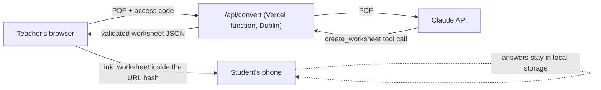

# Architecture

Vocabloom is deliberately small: **no database, no accounts, no runtime dependencies.** A serverless function converts PDFs, and everything else happens in the browser.

## The big picture



- The server **never stores** a PDF, a worksheet or an answer.
- The share link contains the whole worksheet, compressed, after the `#`. Browsers do not send that part to a server.
- Students never talk to the server except to load the page itself.

## Layers

| Layer | Where | Responsibility |
|---|---|---|
| HTTP entry | `api/convert.js`, `server.js` | Orchestrates one request. `server.js` is only the local dev server. |
| Configuration | `lib/config.js` | The only place that reads environment variables, plus the limits. |
| Request rules | `lib/security.js`, `lib/pdf.js`, `lib/http.js` | Security headers, access code, rate limits, PDF checks, JSON responses. |
| AI adapter | `lib/claude.js`, `lib/prompt.js`, `lib/worksheet-schema.js` | The only code that talks to the AI provider. Turns every failure into a safe, user-friendly error. |
| Output safety | `lib/normalize.js` | Reduces whatever the AI returns to the exact shape, types and lengths the page expects. |
| Frontend source | `src/` | Small scripts, grouped by responsibility (below). |
| Build | `scripts/build.js` | Joins `src/` into the single file `public/index.html` and keeps the CSP hash in step. |

Dependencies point inwards: the handler uses `lib/`, and `lib/` never imports the handler.

## Frontend modules (`src/js`)

Order matters, and is listed in `scripts/build.js`. Later files may use earlier ones; never the reverse.

```
core/ui.js           DOM helpers, escaping (esc), toast, clipboard
core/text.js         answer matching (norm, alts), seeded shuffle, slug
core/worksheet.js    data model: defaults, scoring rule
core/grading.js      pure grading rules (no DOM, no state)
share/codec.js       worksheet <-> URL hash (compression, size limits)
share/standalone.js  download as one self-contained .html file
player/state.js      what a student has done (local storage only)
player/items.js      index of questions by id
player/markup.js     HTML for the worksheet (everything escaped)
player/practice.js   optional "Practise your mistakes"
player/player.js     wires it together: feedback, score, events
teacher/upload.js    step 1
teacher/review.js    step 2
teacher/share.js     step 3
teacher/teacher.js   the three steps
main.js              chooses teacher or student mode
```

`core/` and `share/codec.js` have no DOM dependency, so `test/frontend.test.js` runs them in Node.

### Why one built file?
A teacher can download a worksheet as a single `.html` file that works offline. The page does this by re-reading its own source, so the built page must stay one self-contained file. `public/index.html` is therefore **generated**: edit `src/`, then run `npm run build`. The tests fail if the generated files are out of date.

## Security design

| Threat | Defence |
|---|---|
| Strangers spending API credits | Shared access code (constant-time check), limit on wrong codes, limit on conversions per address |
| Malicious or broken AI output | `lib/normalize.js` validates and length-limits it; all text is escaped before display |
| Script injection (XSS) | Strict CSP: only the page's own script runs, identified by its SHA-256 hash. No inline event handlers. No third-party scripts |
| Hostile share links | Link size limit, decompression limit (zip-bomb protection), strict hash format |
| Path traversal on the dev server | `resolvePublicFile` refuses anything outside `public/` |
| Clickjacking, sniffing, leaks | `frame-ancestors 'none'`, `nosniff`, `Referrer-Policy: no-referrer`, HSTS, minimal Permissions-Policy |
| Supply chain | No runtime dependencies; CI runs the tests on every pull request; `main` needs a pull request |
| Leaking provider errors | Provider messages stay in the server log; users see friendly messages |

Known trade-off: styles are `'unsafe-inline'` because the page sets style attributes (for example the width of a blank). Scripts, which matter most for XSS, are locked down by hash.

## Where the CSP hash comes from
`scripts/build.js` hashes the page's inline script and writes it to `lib/csp-hashes.json` and into the header in `vercel.json`. `lib/security.js` reads the same file for the local server, so both always agree. If you change the code and forget to build, `npm test` fails.

## Working on the project

```
npm run build   # after editing anything in src/
npm test        # runs all tests, including "generated files are up to date"
npm run dev     # local server on http://localhost:3000
```

Changes to `main` go through a pull request, and the `test` check must pass.

## Possible next steps
- **School platform** (separate project): accounts, classes, teacher dashboard, results in a database. It would need its own data protection work: see [`COMPLIANCE.md`](COMPLIANCE.md).
- A hard rate limit using the host's firewall (the built-in limits are per server instance).
