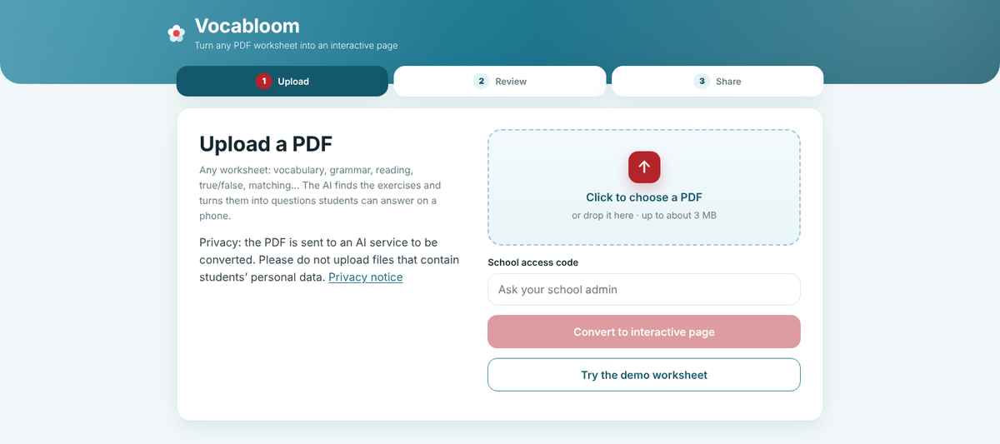
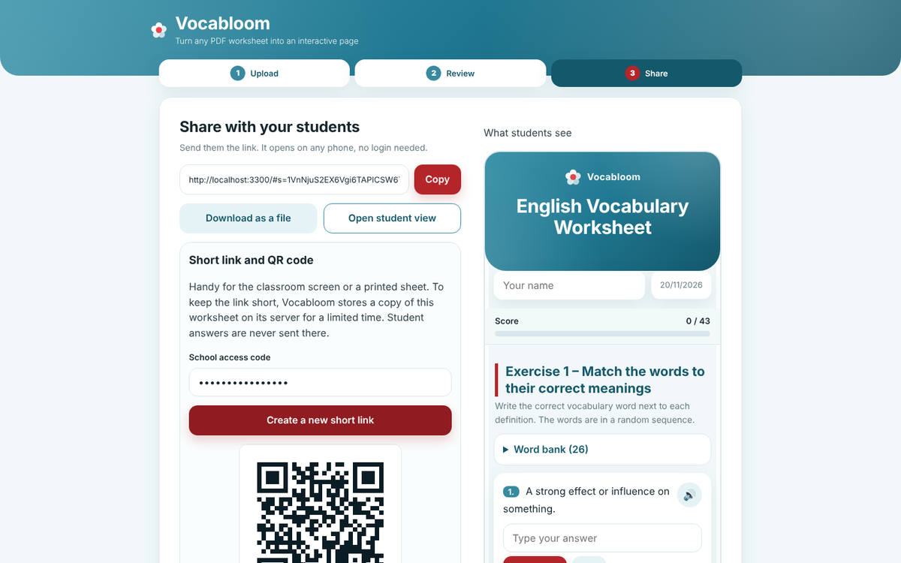
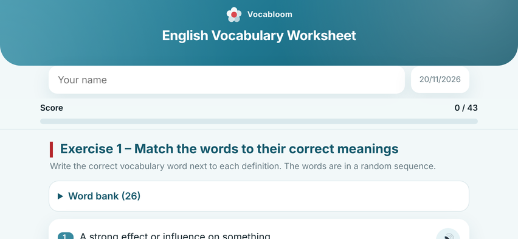
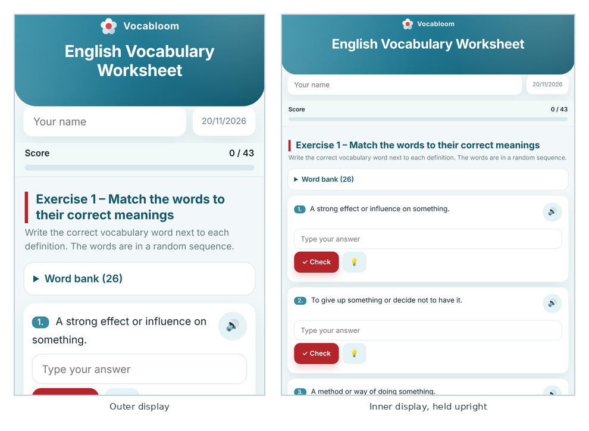
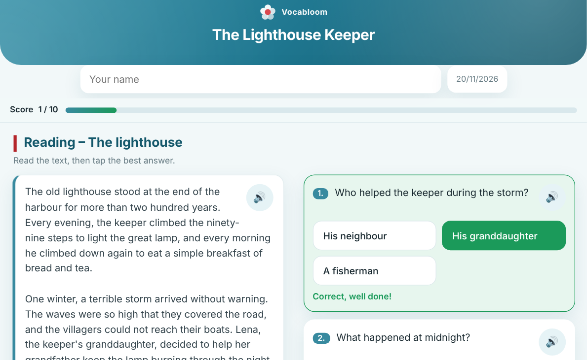

# Phones, computers and foldables

Vocabloom is built phone first and also suits a computer.

- **iPhone.** The page keeps clear of the notch and the home indicator, even held sideways, where the header also shrinks to leave room for the questions. Fields are never small enough to make Safari zoom in, and buttons do not stay highlighted after a tap. The teacher's **Share…** button opens the iPhone's own share sheet (Messages, WhatsApp, Mail), and sends the short link once one exists. An iPhone has no install button, so the review deck shows a tip: **Share**, then **Add to Home Screen**.
- **Computer.** The teacher's tool uses a wider layout: the upload box takes a dropped PDF and can be reached with the keyboard, the review fields sit in two columns, and the share step keeps a preview of the student's page in view beside the link and the QR code. Students get a slightly wider column, the arrow keys move between answer buttons, and Escape closes pop-ups. Hover colours appear only where there is a mouse.
- **iPhone Duo and other foldables.** Nothing detects the phone: the layout follows the size and shape of the window. Safari 27.1 reports 382 × 580 for the outer display (594 × 368 sideways) and 669 × 867 for the inner display (951 × 585 sideways). Held upright, both use the single column, with a tighter header on the outer display. Open sideways, a worksheet becomes a two-page spread: the questions run in two columns, a reading text stays on the left page while the questions scroll on the right, and the gutter sits on the fold. The score and the progress bar share one line when the window is short. When the phone is opened, closed or turned, the student stays on the same question. The teacher's tool uses its two-column layouts from 900 px wide, so it also fits the open inner display. Safari's two fold features (device posture and viewport segments) are off by default (Settings, Apps, Safari, Advanced, Feature Flags). The page does not need them; when they are on it also keeps headings away from the crease and keeps messages in the upper half of a phone folded like a laptop.

  

  

  

  

  

The style rules behind all of this, and why each one exists, are in [`ARCHITECTURE.md`](ARCHITECTURE.md#phones-and-computers). `test/devices.test.js` fails if one of them is removed.
